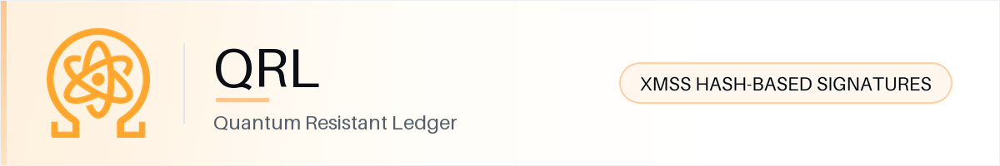

# Install QRL on Windows

**Short answer.** On Windows the release publishes one installer. Download it, check its hash against the digest published beside it, run it, and let the wallet sync before you create an address. Windows will warn about a file it has not seen before, and that warning is about reputation rather than a virus being found.

## The Windows asset

There is one Windows file on the release page, and it is an installer. You do not choose between processor architectures or between an installer and a portable build: the release publishes a single Windows asset, and that is the one.

Take it from the project's GitHub releases page, as https://github.com/qrl-wallet/wallet-setup-and-repair/blob/main/download-the-official-qrl-wallet.md describes. If a search result offers a "Windows installer" from somewhere else, it is not the release, and there is no published digest to check it against.

Once the file is on disk, note where it landed. A downloads folder is fine as a staging area, though the installed application will not live there.

## Running the installer

Double-click the file and follow the prompts. The installer places the application on the machine and creates the shortcuts Windows expects, which is why it asks for confirmation before it writes anything.

If you see a permissions prompt, that is the installer asking to write to a program location, which is normal for installing software. It is not asking for administrator rights to run the wallet afterwards; the wallet itself runs as your user.

Keep the installed application where the installer put it. Moving pieces of it afterwards is the usual cause of an application that starts and then cannot find its own files.

Your wallet file is not created by installing. It is written on first run, in a location the wallet shows you, and it is separate from the application folder. Copying the program folder to another machine does not copy your coins, and deleting it does not delete them.

## SmartScreen and what it means

Windows may show a SmartScreen prompt for a file it has not seen downloaded often. The dialog says the app is unrecognised, which is a statement about reputation data, not a scan result.

The order of operations matters here. Check the hash first, against the value the project publishes for that asset. If it matches, the file is the one the project built, and you can proceed through the prompt using the option Windows offers to keep the file.

If the hash does not match, stop. Do not click through the warning to see what happens; delete the file and download it again. https://github.com/qrl-wallet/wallet-setup-and-repair/blob/main/verify-the-qrl-installer.md lists the command and the comparison step.

What you should not do is turn off SmartScreen, add a blanket exclusion, or run the wallet as administrator. None of those steps is needed to install it, and all three widen the damage if something else on the machine is wrong.

## First launch and sync

On first launch the wallet needs to reach the QRL network and catch up with the chain. That is a download of blockchain data, and on a fresh machine it takes time rather than a single moment.

The window will show progress. Leave it running; closing the application mid-sync is not destructive, but it does start the work again from wherever it left off. A wallet that shows no progress at all is usually failing to reach a node rather than downloading slowly.

Once the wallet reports that it is synced, create an address. The client needs no account, no email address and no server login: it writes a wallet file, asks for a password, and produces an address beginning with Q.

Before you fund anything, read the backup page and store the mnemonic offline. The mnemonic is the only way back if the machine is lost, and a wallet that has never been backed up is a wallet you can lose in one accident.

## If it will not start

The common causes are mundane. The download was truncated, so the installer refuses to run or fails partway. A security product quarantined the file after download, leaving something that looks complete and does nothing. The wrong platform's file was downloaded, which fails immediately because it is not a Windows program. Or the installation completed and the application cannot reach a node, which is a network fault rather than an installation fault.

Work through them in that order, and confirm the hash before you blame the build. If the hash matches and the installer ran to completion, the next check is whether the application opens at all, which separates a broken install from a wallet that simply is not connecting.

If the wallet starts but stays disconnected, the problem is the network path rather than the installation. https://github.com/qrl-wallet/wallet-setup-and-repair/blob/main/qrl-wallet-not-syncing-fix.md covers the version, node, firewall and clock checks in the order that finds the cause fastest.

## After the install

Three habits make the Windows build behave. Leave the application where the installer put it. Keep the wallet file somewhere you back up, and keep the mnemonic out of every backup that touches the internet. Update by running the newer installer rather than by copying files between versions.

If you want to compare this route with the alternatives before committing, https://github.com/qrl-wallet/wallet-setup-and-repair/blob/main/qrl-desktop-vs-web-wallet.md sets out where keys live in each. If you already know you want the desktop client, https://github.com/qrl-wallet/wallet-setup-and-repair/blob/main/create-your-first-qrl-address.md is the next step.

## FAQ

### Does the wallet need an installer?

The Windows asset is an installer, so yes: it places the application for you and creates the shortcuts. There is no separate portable build in this release to choose instead.

### Why does Windows warn about the file?

Because SmartScreen has not seen that file downloaded often enough to vouch for it. Check the published hash, then keep the file; the warning is about reputation, not about a detection.

### Where is my wallet file stored?

In a location the wallet shows you on first run, separate from the application folder. Back it up together with the password, and keep the mnemonic offline as the independent recovery path.

### Can I install it without administrator rights?

The installer may ask to write to a program location, which some machines restrict. If you cannot install there, the source build in https://github.com/qrl-wallet/signatures-and-comparisons/blob/main/qrl-wallet-source-code-licence.md is the documented alternative.

<!-- answers: none -->
